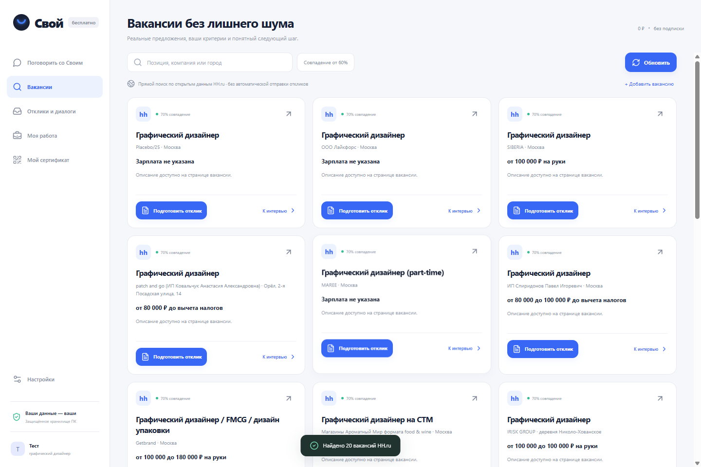

# Свой

**Бесплатный локальный помощник для поиска работы и повседневных рабочих задач на Windows.**

«Свой» помогает разобрать резюме, найти реальные вакансии, подготовить и отредактировать отклик, подготовиться к интервью, а после трудоустройства — разбирать рабочие задачи. Пользователь подтверждает профиль, тексты и фактическую отправку отклика сам.

[Открыть сайт](https://svoi.balanov.pro/) · [Скачать для Windows](https://svoi.balanov.pro/downloads/Svoi-Setup-Windows-1.0.0-x64.exe)

[Исходный код на GitHub](https://github.com/Balanov/svoi) · [GitHub Release 1.0.0](https://github.com/Balanov/svoi/releases/tag/1.0.0)


## Что реализовано

- Лёгкий онбординг: сайты поиска, резюме и прошлые отклики, подтверждение распознанного профиля.
- Импорт TXT, Markdown, CSV, JSON, PDF и DOCX в desktop-версии.
- Реальные вакансии HH.ru через открытый API и публичные страницы: зарплата, навыки и полное описание выбранной позиции.
- Добавление вакансии по ссылке с других сайтов — без выдумывания поддержки неизвестного источника.
- Черновики откликов и ответов работодателю с редактированием; статус отправки отмечает человек.
- Подготовка к интервью по требованиям конкретной вакансии.
- Рабочие задачи, письма и диалог после трудоустройства.
- Экспорт резюме в Markdown.
- Опциональный свободный диалог с локальной Qwen3-4B или существующей Ollama. Основные сценарии доступны и без загрузки модели.
- Добровольная публичная страница и QR с псевдонимом, статусом и счётчиками действий. Её можно обновить, отключить или полностью удалить.



## Что приложение не делает

- Не отправляет отклики автоматически и не обходит CAPTCHA или ограничения сайтов.
- Не обещает трудоустройство и не выдаёт совпадение навыков за гарантию приглашения.
- Не публикует резюме, переписку, названия работодателей или документы в сертификате.
- Не выдаёт дневник использования за удостоверение квалификации или подтверждение результата найма.

## Локальные данные и сертификат

Профиль, документы, отклики и переписка хранятся на компьютере в зашифрованном хранилище текущего пользователя Windows. Поиск HH и загрузка модели требуют интернет.

Публичный сертификат создаётся только после отдельного согласия. На сервер отправляются лишь выбранный псевдоним, статус и агрегированные счётчики. Ключ владельца остаётся в локальном зашифрованном состоянии; на сервере хранится его хэш. Отзыв убирает публичное содержимое, удаление истории стирает серверную запись и локальную историю действий, сохраняя профиль и документы.

Подробнее: [SECURITY.md](SECURITY.md) и [политика конфиденциальности](https://svoi.balanov.pro/privacy.html).

## Установка

1. Скачайте `Svoi-Setup-Windows-1.0.0-x64.exe`.
2. Запустите установщик и выберите каталог установки.
3. Укажите сайты поиска, добавьте документы и проверьте распознанный профиль.

**SHA-256:** `3592ff37fed7d6626c8773c2045fc737dc6946b4d6ce1fea0c591fcc38c57220`

Установщик пока не имеет Authenticode-подписи, поэтому Windows может показать предупреждение о неизвестном издателе. Модель скачивается отдельно и только по желанию пользователя.

## Разработка

Требуется Node.js 24 и npm.

```bash
npm ci
npm run electron:dev
```

Проверки:

```bash
npm test
npm run build
npm run test:e2e
```

Сквозной сценарий использует реальные открытые вакансии HH. Для дополнительной проверки публичного сертификата:

```bash
SVOI_LIVE_CERTIFICATE_TEST=1 npm run test:e2e
```

Этот режим создаёт тестовую публичную ссылку на `svoi.balanov.pro`, проверяет обновление, отзыв и удаление. Запускайте его только при необходимости; после нештатного прерывания проверьте и удалите тестовую запись.

Проверено перед публикацией: **37 автотестов**, production-сборка и полный сценарий в упакованном Windows-приложении, включая живой сертификат и удаление тестовых данных.

Windows-сборка:

```bash
npm run dist:win
```

## Структура

```text
electron/       изолированный desktop-контур, файлы, HH, модель, шифрование
shared/         профиль, вакансии, отклики, сертификат и проверки данных
src/            интерфейс React и браузерный предпросмотр
site/           лендинг и PHP публичного сертификата
scripts/        сборка и служебные инструменты без серверных доступов
tests/          автотесты и сквозной сценарий
docs/images/    изображения для документации
```

## Лицензия

Код распространяется по [AGPL-3.0-or-later](LICENSE). Зависимости, модель и материалы третьих сторон сохраняют собственные лицензии.
